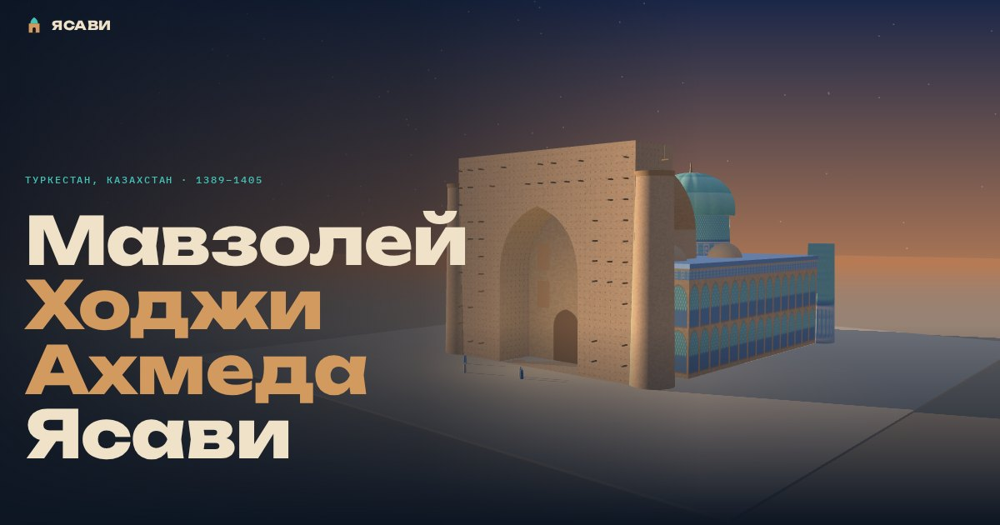

# Мавзолей Ходжи Ахмеда Ясави

Информационный сайт о мавзолее Ходжи Ахмеда Ясави в Туркестане (Казахстан). Школьный проект.

**Сайт:** https://yussfv1.github.io



## Что на сайте

- **Ясави.** Кто такой Ходжа Ахмед Ясави и чем известен «Диван-и Хикмет».
- **История.** Лента времени от 1166 до 2003 года, которая заполняется при прокрутке.
- **3D-модель.** Мавзолей можно вращать и приближать. Семь точек рассказывают о деталях здания, есть режимы «день», «закат» и «ночь».
- **Залы.** Схема помещений: Казандык, Гурхана, мечеть, библиотека и другие.
- **Портал.** Почему главный вход остался недостроенным.
- **Узоры.** Редактор, в котором узор отражается в четыре стороны, как облицовка на стенах.
- **Тайказан.** Сравнение котла с ростом человека и история его возвращения из Эрмитажа.
- **Легенды и тест.** Предания о мавзолее и семь вопросов для проверки.

## Как устроен

Обычный статический сайт без сборки: HTML, CSS и JavaScript.

```
index.html          страница
assets/style.css    оформление
assets/main.js      анимации, 3D-модель, схема залов, редактор узоров, тест
assets/fonts/       шрифты Unbounded, Golos Text, IBM Plex Mono
assets/vendor/      библиотека three.js r128 для 3D
```

3D-модель не скачана готовой, а собрана в коде из простых фигур по реальным пропорциям здания: план 46,5 × 65,5 м, портал 37,5 м, высота 38,7 м. Узоры на стенах нарисованы программно по мотивам настоящей облицовки.

Все файлы лежат в репозитории, поэтому сайт не зависит от внешних сервисов.

## Как открыть у себя

Скачай репозиторий (Code → Download ZIP) и открой `index.html` в браузере. Если 3D не появилось, запусти простой сервер в папке сайта:

```
python -m http.server 8000
```

и открой http://localhost:8000.

## Источники

- [ЮНЕСКО: Mausoleum of Khoja Ahmed Yasawi](https://whc.unesco.org/en/list/1103)
- [Музей-заповедник «Әзірет Сұлтан»](https://azretsultan.kz/rus/mavzolej-hodzha-ahmeda-yasavi/)
- [Википедия: Мавзолей Ходжи Ахмеда Ясави](https://ru.wikipedia.org/wiki/Мавзолей_Ходжи_Ахмеда_Ясави)
- [История тайказана (stan.kz)](https://stan.kz/lyudi-v-turkestane-plakali-ot-radosti-istoriya-taykazan-347839/)

## Лицензии

- Код сайта: MIT, см. [LICENSE](LICENSE).
- three.js: MIT, см. [assets/vendor/three-LICENSE.txt](assets/vendor/three-LICENSE.txt).
- Шрифты: SIL Open Font License 1.1, см. файлы `assets/fonts/*-OFL.txt`.
